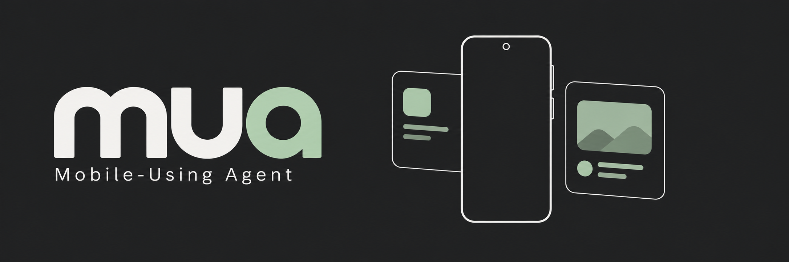

# mua (Mobile-Using Agent)

mua exposes Android apps to MCP clients through Shizuku-powered virtual displays.
Create displays, launch apps, capture screenshots, and inject touch and key input
while the phone’s physical screen is off. Connect directly to the phone or use
the optional central server to access multiple devices through one MCP endpoint.

## Get started

You need Android 12 or newer, a running [Shizuku](https://shizuku.rikka.app/)
installation authorized through ADB or root, and an MCP client supporting
Streamable HTTP.

1. Build with `./gradlew :mua:assembleDebug` and install
   `mua/build/outputs/apk/debug/mua-debug.apk`.
2. Open **mua** and grant Shizuku permission. Select `0.0.0.0` as the listening
   address to connect from another device on your network, then tap **Start mua**.
3. Copy the endpoint URL and **Authorization** value from **Client connection**
   into your MCP client.
4. Call `display_start`, then use the returned `displayId` to launch apps,
   capture screenshots, and send input.

See the [mua quick start](mua/README.md) and
[configuration and MCP tools](docs/mua.md) for details. For screen-off sessions,
use the battery optimization setup card. mua keeps the CPU awake while virtual
displays are active.

## Central server

The optional [mua server](server/README.md) connects devices through outbound
WebSockets and exposes their tools through a single MCP endpoint. Use
`devices_list` to find connected devices, then pass `deviceId` to device tools.
The server uses FastAPI and uv and can run in Docker.

See [central gateway setup](docs/mua-remote.md) for device registration,
authentication, and deployment.

## Project modules

- [mua](mua/README.md): Android MCP app.
- [server](server/README.md): central MCP gateway for multiple devices.
- [display-control](display-control/README.md): shared Shizuku virtual display,
  screenshot, app launching, and input injection library.
- [Neko Assistant](docs/neko-assistant.md) (`app`): companion Android app with
  an LLM agent and chat harness, inspired by
  [Doubao Phone Assistant](https://o.doubao.com/).

## Development

See [build and validation](docs/development.md) for build commands, release
signing, GitHub Actions, and device checks.
